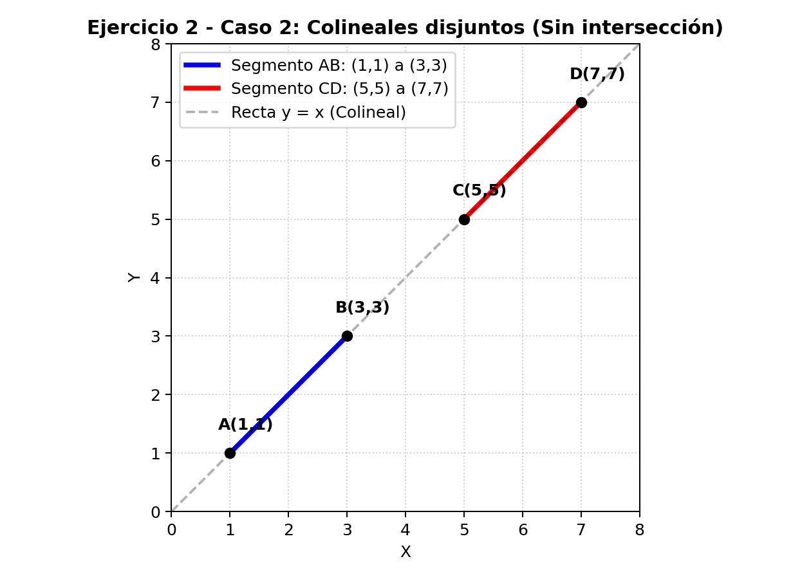

# Taller de Algoritmos: Geometría Computacional

> **Taller práctico y teórico:** Solución analítica, demostraciones matemáticas, complejidad algorítmica $T(n)$ y programas ejecutables en Python con soporte gráfico.

---

## Tabla de Contenidos
1. [Fundamentos Teóricos: Orientación en el Plano](#fundamentos-teóricos-orientación-en-el-plano)
2. [Ejercicio 1: Dirección del Giro del Robot Autónomo](#ejercicio-1-dirección-del-giro-del-robot-autónomo)
   - [1. Cálculo del determinante para cada caso](#1-cálculo-del-determinante-para-cada-caso)
   - [2. Clasificación y código en Python](#2-clasificación-y-código-en-python)
   - [3. Análisis de complejidad temporal $T(n)$](#3-análisis-de-complejidad-temporal-tn)
3. [Ejercicio 2: Intersección de Rutas de Autos Autónomos](#ejercicio-2-intersección-de-rutas-de-autos-autónomos)
   - [1. Representación en el plano cartesiano](#1-representación-en-el-plano-cartesiano)
   - [2. Cálculo de las 4 orientaciones](#2-cálculo-de-las-4-orientaciones)
   - [3. Determinación de intersección (Cruce, contacto y superposición)](#3-determinación-de-intersección)
   - [4. Implementación en Python: función `interseccion`](#4-implementación-en-python-función-interseccion)
   - [5. Demostración de complejidad $O(1)$](#5-demostración-de-complejidad-o1)
4. [Ejercicio 3: Detección de Cruces entre $N$ Tuberías](#ejercicio-3-detección-de-cruces-entre-n-tuberías)
5. [Ejercicio 4: Triangulación de un Terreno (Ear Clipping)](#ejercicio-4-triangulación-de-un-terreno-ear-clipping)
6. [Instrucciones para Ejecución y Generación de Gráficos](#instrucciones-para-ejecución)

---

## Fundamentos Teóricos: Orientación en el Plano

La herramienta matemática central de la geometría computacional bidimensional es la **función de orientación** o **producto cruz 2D** entre vectores.

Dados tres puntos $P(x_P, y_P)$, $Q(x_Q, y_Q)$ y $R(x_R, y_R)$, el determinante de la matriz homogénea 2D corresponde al doble del área signada del triángulo $\triangle PQR$:

$$
\operatorname{orient}(P, Q, R) = \det \begin{pmatrix} x_P & y_P & 1 \\ x_Q & y_Q & 1 \\ x_R & y_R & 1 \end{pmatrix} = (x_Q - x_P)(y_R - y_P) - (y_Q - y_P)(x_R - x_P)
$$

### Criterio de Decisión

| Signo del Determinante | Orientación Geométrica | Comportamiento del Móvil |
| :---: | :---: | :--- |
| $\Delta > 0$ | **Antihorario (CCW)** | El punto $R$ queda a la izquierda del vector $\vec{PQ}$ (giro a la izquierda). |
| $\Delta < 0$ | **Horario (CW)** | El punto $R$ queda a la derecha del vector $\vec{PQ}$ (giro a la derecha). |
| $\Delta = 0$ | **Colineal** | Los tres puntos yacen sobre la misma recta (continúa recto o da reversa). |

---

## Ejercicio 1: Dirección del Giro del Robot Autónomo

Un robot autónomo se desplaza dentro de una bodega. Para determinar si debe girar a la izquierda, a la derecha o continuar en línea recta, analiza tres posiciones consecutivas:
* $A$: Posición anterior
* $B$: Posición actual
* $C$: Posición de destino


---

### 1. Cálculo del determinante para cada caso

Utilizamos la fórmula:
$$\Delta = (x_B - x_A)(y_C - y_A) - (y_B - y_A)(x_C - x_A)$$

#### **Caso 1: $A(1,2)$, $B(5,3)$, $C(3,7)$**
* Vector $\vec{AB} = (5 - 1, 3 - 2) = (4, 1)$
* Vector $\vec{AC} = (3 - 1, 7 - 2) = (2, 5)$
* Sustitución:
  $$\Delta_1 = (4)(5) - (1)(2) = 20 - 2 = \mathbf{18}$$
* **Resultado:** $\Delta_1 > 0 \implies$ **Giro Antihorario (a la izquierda)**.

#### **Caso 2: $A(2,1)$, $B(6,5)$, $C(8,2)$**
* Vector $\vec{AB} = (6 - 2, 5 - 1) = (4, 4)$
* Vector $\vec{AC} = (8 - 2, 2 - 1) = (6, 1)$
* Sustitución:
  $$\Delta_2 = (4)(1) - (4)(6) = 4 - 24 = \mathbf{-20}$$
* **Resultado:** $\Delta_2 < 0 \implies$ **Giro Horario (a la derecha)**.

#### **Caso 3: $A(1,1)$, $B(3,3)$, $C(6,6)$**
* Vector $\vec{AB} = (3 - 1, 3 - 1) = (2, 2)$
* Vector $\vec{AC} = (6 - 1, 6 - 1) = (5, 5)$
* Sustitución:
  $$\Delta_3 = (2)(5) - (2)(5) = 10 - 10 = \mathbf{0}$$
* **Resultado:** $\Delta_3 = 0 \implies$ **Colineal (continúa recto)**.

#### **Caso 4: $A(0,4)$, $B(5,4)$, $C(3,1)$**
* Vector $\vec{AB} = (5 - 0, 4 - 4) = (5, 0)$
* Vector $\vec{AC} = (3 - 0, 1 - 4) = (3, -3)$
* Sustitución:
  $$\Delta_4 = (5)(-3) - (0)(3) = -15 - 0 = \mathbf{-15}$$
* **Resultado:** $\Delta_4 < 0 \implies$ **Giro Horario (a la derecha)**.

---

### Resumen de Resultados del Ejercicio 1

| Caso | Posición Anterior ($A$) | Posición Actual ($B$) | Posición Destino ($C$) | Determinante ($\Delta$) | Clasificación del Giro |
|:---:|:---:|:---:|:---:|:---:|:---|
| **1** | $(1, 2)$ | $(5, 3)$ | $(3, 7)$ | **$+18$** | **Antihorario (Izquierda)** |
| **2** | $(2, 1)$ | $(6, 5)$ | $(8, 2)$ | **$-20$** | **Horario (Derecha)** |
| **3** | $(1, 1)$ | $(3, 3)$ | $(6, 6)$ | **$0$** | **Colineal (Recto)** |
| **4** | $(0, 4)$ | $(5, 4)$ | $(3, 1)$ | **$-15$** | **Horario (Derecha)** |

---

### 2. Clasificación y código en Python

```python
def orientacion(A, B, C):
    """
    Calcula el determinante del producto cruz 2D entre los vectores AB y AC.
    Retorna > 0 si es antihorario, < 0 si es horario, == 0 si son colineales.
    """
    return (B[0] - A[0]) * (C[1] - A[1]) - (B[1] - A[1]) * (C[0] - A[0])

def clasificar_giro(det):
    """Clasifica el valor del determinante en tipo de giro."""
    if det > 0:
        return "Giro Antihorario (Izquierda)"
    elif det < 0:
        return "Giro Horario (Derecha)"
    else:
        return "Colineal (Sin giro / Línea recta)"

# Casos dados en el taller
datos_ejercicio_1 = {
    "Caso 1": ((1, 2), (5, 3), (3, 7)),
    "Caso 2": ((2, 1), (6, 5), (8, 2)),
    "Caso 3": ((1, 1), (3, 3), (6, 6)),
    "Caso 4": ((0, 4), (5, 4), (3, 1)),
}

if __name__ == "__main__":
    print("=== RESULTADOS EJERCICIO 1 ===")
    for nombre, (A, B, C) in datos_ejercicio_1.items():
        det = orientacion(A, B, C)
        giro = clasificar_giro(det)
        print(f"{nombre}: A={A}, B={B}, C={C} -> det = {det:>3} | {giro}")
```

---

### 3. Análisis de complejidad temporal $T(n)$

Para evaluar el tiempo de ejecución bajo el **Modelo de Máquina RAM (Random Access Machine)**:

#### A. Para una terna de puntos individual
1. Se realizan 4 sustracciones: $(x_B - x_A)$, $(y_C - y_A)$, $(y_B - y_A)$, $(x_C - x_A)$.
2. Se realizan 2 multiplicaciones.
3. Se realiza 1 sustracción final para hallar $\Delta$.
4. Se ejecutan comparaciones condicionales (`> 0`, `< 0`, `== 0`).

Todas las operaciones anteriores son aritméticas elementales con costo fijo $c_1$.
$$T_{\text{individual}} = c_1 = \mathbf{O(1)}$$

#### B. Para una trayectoria o secuencia de $n$ puntos
Si el robot navega a través de una ruta compuesta por $n$ waypoints consecutivos $P_1, P_2, \dots, P_n$:
El robot evalúa $(n - 2)$ ternas sucesivas $(P_{i-1}, P_i, P_{i+1})$:

$$T(n) = \sum_{i=2}^{n-1} c_1 = c_1 \cdot (n - 2) + c_2$$

Aplicando el análisis asintótico:
$$T(n) = c_1 n - 2c_1 + c_2 \implies \mathbf{T(n) = \Theta(n) \quad \text{o} \quad O(n)}$$

* **Tiempo:** **Lineal** respecto al número de posiciones analizadas.
* **Espacio Auxiliar:** $O(1)$, ya que solo se almacenan variables escalares en memoria.

---

## Ejercicio 2: Intersección de Rutas de Autos Autónomos

Dos segmentos $AB$ y $CD$ en el plano cartesiano pueden presentar tres situaciones:
1. **Cruce propio (Transversal):** Las rectas se cortan en un punto interior a ambos segmentos.
2. **Cruce impropio o Contacto:** Un extremo de un segmento toca al otro segmento o coinciden en un vértice común.
3. **Superposición (Colineales traslapados):** Ambos segmentos yacen sobre la misma línea y comparten un intervalo continuo de puntos.
4. **Disjuntos:** No comparten ningún punto.

---

### 1. Representación en el plano cartesiano

#### **Caso 1: Cruce transversal propio**
* Segmento $AB$: $A(1, 1) \to B(7, 5)$
* Segmento $CD$: $C(2, 6) \to D(8, 1)$


#### **Caso 2: Segmentos colineales disjuntos**
* Segmento $AB$: $A(1, 1) \to B(3, 3)$
* Segmento $CD$: $C(5, 5) \to D(7, 7)$



#### **Caso 3: Subcasos para $A(0,2)$, $B(6,2)$**
Dado que el enunciado plantea el segmento $AB$ horizontal sobre $y=2$ desde $x=0$ hasta $x=6$, se presentan los tres escenarios posibles para un segmento $CD$:
* **3a (Cruce transversal):** $C(3, 0), D(3, 5)$
* **3b (Contacto en extremo):** $C(6, 2), D(9, 5)$
* **3c (Superposición colineal):** $C(4, 2), D(9, 2)$


---

### 2. Cálculo de las 4 orientaciones

Para determinar si dos segmentos $AB$ y $CD$ se cortan, se calculan las cuatro orientaciones relativas:
* $\mathcal{O}_1 = \operatorname{orient}(A, B, C)$: orientación de $C$ respecto a la recta $AB$.
* $\mathcal{O}_2 = \operatorname{orient}(A, B, D)$: orientación de $D$ respecto a la recta $AB$.
* $\mathcal{O}_3 = \operatorname{orient}(C, D, A)$: orientación de $A$ respecto a la recta $CD$.
* $\mathcal{O}_4 = \operatorname{orient}(C, D, B)$: orientación de $B$ respecto a la recta $CD$.

---

#### **Cálculo Caso 1:** $A(1,1), B(7,5)$ y $C(2,6), D(8,1)$

1. **$\mathcal{O}_1 = \operatorname{orient}(A, B, C)$:**
   $$\vec{AB} = (6, 4), \quad \vec{AC} = (1, 5) \implies \mathcal{O}_1 = (6)(5) - (4)(1) = 30 - 4 = \mathbf{+26} \quad (> 0)$$
2. **$\mathcal{O}_2 = \operatorname{orient}(A, B, D)$:**
   $$\vec{AB} = (6, 4), \quad \vec{AD} = (7, 0) \implies \mathcal{O}_2 = (6)(0) - (4)(7) = 0 - 28 = \mathbf{-28} \quad (< 0)$$
3. **$\mathcal{O}_3 = \operatorname{orient}(C, D, A)$:**
   $$\vec{CD} = (6, -5), \quad \vec{CA} = (-1, -5) \implies \mathcal{O}_3 = (6)(-5) - (-5)(-1) = -30 - 5 = \mathbf{-35} \quad (< 0)$$
4. **$\mathcal{O}_4 = \operatorname{orient}(C, D, B)$:**
   $$\vec{CD} = (6, -5), \quad \vec{CB} = (5, -1) \implies \mathcal{O}_4 = (6)(-1) - (-5)(5) = -6 - (-25) = \mathbf{+19} \quad (> 0)$$

---

#### **Cálculo Caso 2:** $A(1,1), B(3,3)$ y $C(5,5), D(7,7)$
Todos los puntos pertenecen a la recta $y = x$:
1. $\mathcal{O}_1 = \operatorname{orient}(A, B, C) = (2)(4) - (2)(4) = \mathbf{0}$
2. $\mathcal{O}_2 = \operatorname{orient}(A, B, D) = (2)(6) - (2)(6) = \mathbf{0}$
3. $\mathcal{O}_3 = \operatorname{orient}(C, D, A) = (2)(-4) - (2)(-4) = \mathbf{0}$
4. $\mathcal{O}_4 = \operatorname{orient}(C, D, B) = (2)(-2) - (2)(-2) = \mathbf{0}$

---

#### **Cálculo Caso 3:** $A(0,2), B(6,2)$ frente a tres variantes de $CD$

| Variante | $C$ | $D$ | $\mathcal{O}_1 (ABC)$ | $\mathcal{O}_2 (ABD)$ | $\mathcal{O}_3 (CDA)$ | $\mathcal{O}_4 (CDB)$ |
|:---|:---:|:---:|:---:|:---:|:---:|:---:|
| **3a (Cruce vertical)** | $(3, 0)$ | $(3, 5)$ | $(6)(-2)-(0)(3) = \mathbf{-12}$ | $(6)(3)-(0)(3) = \mathbf{+18}$ | $(0)(2)-(5)(-3) = \mathbf{+15}$ | $(0)(2)-(5)(3) = \mathbf{-15}$ |
| **3b (Contacto en $B$)** | $(6, 2)$ | $(9, 5)$ | $(6)(0)-(0)(6) = \mathbf{0}$ | $(6)(3)-(0)(9) = \mathbf{+18}$ | $(3)(0)-(3)(-6) = \mathbf{+18}$ | $(3)(0)-(3)(0) = \mathbf{0}$ |
| **3c (Superposición)** | $(4, 2)$ | $(9, 2)$ | $\mathbf{0}$ | $\mathbf{0}$ | $\mathbf{0}$ | $\mathbf{0}$ |

---

### 3. Determinación de intersección

1. **Condición de cruce propio (General):**
   Existe cruce estricto si y solo si:
   $$\operatorname{signo}(\mathcal{O}_1) \neq \operatorname{signo}(\mathcal{O}_2) \quad \text{y} \quad \operatorname{signo}(\mathcal{O}_3) \neq \operatorname{signo}(\mathcal{O}_4)$$
   * En **Caso 1**: $\mathcal{O}_1 > 0$, $\mathcal{O}_2 < 0$ (signos opuestos) y $\mathcal{O}_3 < 0$, $\mathcal{O}_4 > 0$ (signos opuestos).
     $$\implies \mathbf{\text{SÍ existe intersección propia.}}$$
     *El punto exacto de intersección es:* $P = \left(\frac{44}{9}, \frac{32}{9}\right) \approx (4.89, 3.56)$.

2. **Condición de colinealidad y contacto (Casos límites):**
   Si alguna orientación $\mathcal{O} = 0$, los tres puntos involucrados son colineales. La intersección existe si y solo si el punto colineal se encuentra proyectado dentro de la caja delimitadora (Bounding Box) del segmento opuesto:
   $$\min(x_P, x_R) \le x_Q \le \max(x_P, x_R) \quad \land \quad \min(y_P, y_R) \le y_Q \le \max(y_P, y_R)$$
   * En **Caso 2**: Los cuatro determinantes son 0. Verificando intervalos en $X$:
     * Segmento $AB$ cubre $[1, 3]$
     * Segmento $CD$ cubre $[5, 7]$
     * Como $[1, 3] \cap [5, 7] = \emptyset \implies \mathbf{\text{NO existe intersección}}$.
   * En **Caso 3a**: Cruce propio ($\mathcal{O}_1 \cdot \mathcal{O}_2 < 0$ y $\mathcal{O}_3 \cdot \mathcal{O}_4 < 0$) $\implies \mathbf{\text{SÍ hay intersección}}$ en $(3, 2)$.
   * En **Caso 3b**: $\mathcal{O}_1 = 0$ y el punto $C(6,2)$ coincide con el extremo $B(6,2)$ $\implies \mathbf{\text{SÍ hay intersección (contacto)}}$.
   * En **Caso 3c**: Todos son colineales y el intervalo en $X$ $[0, 6]$ se solapa con $[4, 9]$ en $[4, 6]$ $\implies \mathbf{\text{SÍ hay intersección (superposición)}}$.

---

### 4. Implementación en Python: función `interseccion`

```python
def signo(val):
    """Devuelve 1 si es positivo, -1 si es negativo y 0 si es cero."""
    if val > 0:
        return 1
    elif val < 0:
        return -1
    return 0

def orientacion(P, Q, R):
    """Calcula el producto cruz 2D para la orientación de P -> Q -> R."""
    return (Q[0] - P[0]) * (R[1] - P[1]) - (Q[1] - P[1]) * (R[0] - P[0])

def en_segmento(P, Q, R):
    """
    Determina si el punto Q (colineal con el segmento PR)
    se encuentra contenido dentro de los límites del segmento PR.
    """
    return (min(P[0], R[0]) <= Q[0] <= max(P[0], R[0]) and
            min(P[1], R[1]) <= Q[1] <= max(P[1], R[1]))

def interseccion(A, B, C, D):
    """
    Verifica si el segmento AB y el segmento CD se intersectan,
    incluyendo cruce transversal, contacto en extremos y superposiciones.
    """
    # 1. Calcular las cuatro orientaciones
    o1 = signo(orientacion(A, B, C))
    o2 = signo(orientacion(A, B, D))
    o3 = signo(orientacion(C, D, A))
    o4 = signo(orientacion(C, D, B))

    # 2. Caso General: Cruce transversal propio
    if o1 != o2 and o3 != o4 and (o1 != 0 and o2 != 0 and o3 != 0 and o4 != 0):
        return True

    # 3. Casos Especiales: Colinealidad y contacto en bordes
    if o1 == 0 and en_segmento(A, C, B):
        return True
    if o2 == 0 and en_segmento(A, D, B):
        return True
    if o3 == 0 and en_segmento(C, A, D):
        return True
    if o4 == 0 and en_segmento(C, B, D):
        return True

    # Si ninguna condición se cumple, no se intersectan
    return False


if __name__ == "__main__":
    print("=== RESULTADOS EJERCICIO 2 ===")
    
    # Caso 1
    c1 = interseccion((1, 1), (7, 5), (2, 6), (8, 1))
    print(f"Caso 1 (Cruce Propio)     : {c1}")  # True
    
    # Caso 2
    c2 = interseccion((1, 1), (3, 3), (5, 5), (7, 7))
    print(f"Caso 2 (Colineal Disjunto): {c2}")  # False
    
    # Caso 3 (Variantes)
    c3a = interseccion((0, 2), (6, 2), (3, 0), (3, 5))
    print(f"Caso 3a (Cruce Transversal): {c3a}")  # True
    
    c3b = interseccion((0, 2), (6, 2), (6, 2), (9, 5))
    print(f"Caso 3b (Contacto Extremo) : {c3b}")  # True
    
    c3c = interseccion((0, 2), (6, 2), (4, 2), (9, 2))
    print(f"Caso 3c (Superposición)    : {c3c}")  # True
```

---

### 5. Demostración de complejidad $O(1)$

> **Pregunta del taller:** *¿Por qué la detección de una intersección entre dos segmentos de recta tiene complejidad $O(1)$?*

#### Demostración formal:
1. **Número finito y constante de operaciones:**
   * La función siempre ejecuta **exactamente 4 cálculos de orientación**.
   * Cada orientación realiza un número fijo de operaciones aritméticas elementales: 4 restas, 2 productos y 1 diferencia (7 operaciones por orientación $\times 4 = 28$ operaciones).
   * En el peor de los casos (cuando hay puntos colineales), se evalúan a lo sumo **4 funciones `en_segmento`**, cada una consistente en 4 comparaciones numéricas de rango (`min`, `max`, `<=`).
2. **Independencia del tamaño de la entrada o longitud de los segmentos:**
   * Las operaciones se realizan directamente sobre las 8 coordenadas escalares de entrada $(x_A, y_A, x_B, y_B, x_C, y_C, x_D, y_D)$.
   * El algoritmo **no contiene bucles (`for`, `while`)**, ni llamadas recursivas, ni depende de la longitud métrica del segmento ni de ninguna discretización.
3. **Conclusión asintótica:**
   $$T = k \cdot c = O(1)$$
   $$\text{Espacio Auxiliar } S = O(1)$$
   El tiempo de ejecución y la memoria son rigurosamente **constantes**.

---

## Ejercicio 3: Detección de Cruces entre $N$ Tuberías

En una red de distribución logística, se evalúan posibles cruces entre pares de tuberías mediante dos bucles anidados:

```python
for i in range(n):
    for j in range(i + 1, n):
        interseccion(tubos[i], tubos[j])
```


### 1. ¿Por qué se utiliza `j = i + 1`?
* **Evita la auto-comprobación ($i = j$):** Una tubería no puede cruzarse consigo misma.
* **Evita comprobaciones duplicadas:** La intersección es una relación simétrica: `interseccion(A, B) == interseccion(B, A)`. Al empezar en $i + 1$, el par $(i, j)$ se evalúa una única vez.

### 2. Tablas de iteraciones

#### Para $N = 5$:
| Valor de $i$ | Valores tomados por $j$ | Número de comprobaciones |
| :---: | :--- | :---: |
| $0$ | $1, 2, 3, 4$ | $4$ |
| $1$ | $2, 3, 4$ | $3$ |
| $2$ | $3, 4$ | $2$ |
| $3$ | $4$ | $1$ |
| $4$ | *(ninguno)* | $0$ |
| **Total** | | **$10$** |

#### Para $N = 8$:
$$\text{Total} = 7 + 6 + 5 + 4 + 3 + 2 + 1 + 0 = \mathbf{28 \text{ comprobaciones}}$$

### 3. Expresión matemática exacta de $T(n)$
$$T(n) = \sum_{i=0}^{n-1} \sum_{j=i+1}^{n-1} 1 = \sum_{i=0}^{n-1} (n - 1 - i) = (n - 1) + (n - 2) + \dots + 1 + 0$$

Por la suma de Gauss:
$$T(n) = \frac{n(n - 1)}{2} = \binom{n}{2}$$

### 4. Simplificación y orden de complejidad
$$T(n) = \frac{1}{2}n^2 - \frac{1}{2}n \implies \mathbf{T(n) = \Theta(n^2)}$$

### 5. Escala para grandes volúmenes de tuberías

| Número de tuberías ($n$) | Fórmula $\frac{n(n-1)}{2}$ | Total de comprobaciones requeridas |
| :---: | :---: | :---: |
| **$100$** | $\frac{100 \times 99}{2}$ | **$4,950$** |
| **$1,000$** | $\frac{1000 \times 999}{2}$ | **$499,500$** |
| **$10,000$** | $\frac{10000 \times 9999}{2}$ | **$49,995,000$** |

---

## Ejercicio 4: Triangulación de un Terreno (Ear Clipping)

Se tiene un polígono que delimita un terreno con los vértices orientados en sentido antihorario:
$$A(0,0) \to B(8,0) \to C(8,6) \to D(4,3) \to E(0,6) \to A$$


### 1. Clasificación de vértices (Convexos vs. Cóncavos)
Como el recorrido del polígono es antihorario, un vértice $V_i$ con vecinos $V_{i-1}$ y $V_{i+1}$ es:
* **Convexo** si $\operatorname{orient}(V_{i-1}, V_i, V_{i+1}) > 0$.
* **Cóncavo (o reflejo)** si $\operatorname{orient}(V_{i-1}, V_i, V_{i+1}) < 0$.

| Vértice | Vecino Anterior | Vecino Siguiente | Determinante $\Delta$ | Tipo de Vértice | ¿Es oreja válida? |
|:---:|:---:|:---:|:---:|:---:|:---|
| **$A(0,0)$** | $E(0,6)$ | $B(8,0)$ | $+48$ | Convexo | No (la diagonal $EB$ contiene a $D$) |
| **$B(8,0)$** | $A(0,0)$ | $C(8,6)$ | $+48$ | Convexo | No (la diagonal $AC$ contiene a $D$) |
| **$C(8,6)$** | $B(8,0)$ | $D(4,3)$ | $+24$ | Convexo | **Sí (Oreja válida inicial)** |
| **$D(4,3)$** | $C(8,6)$ | $E(0,6)$ | $\mathbf{-24}$ | **Cóncavo** | **No** (vértice reflejo) |
| **$E(0,6)$** | $D(4,3)$ | $A(0,0)$ | $+24$ | Convexo | **Sí (Oreja válida)** |

### 2. Fórmulas de triangulación para polígonos simples ($n=5$)
* **Número de triángulos:** $N_T = n - 2 = 5 - 2 = \mathbf{3 \text{ triángulos}}$.
* **Número de diagonales internas:** $N_D = n - 3 = 5 - 3 = \mathbf{2 \text{ diagonales}}$.

### 3. Triangulación final obtenida
Las dos diagonales internas que dividen el polígono sin cruzarse son $BD$ y $AD$:
1. $\triangle BCD$ (Área = $12$)
2. $\triangle ABD$ (Área = $12$)
3. $\triangle ADE$ (Área = $12$)
* **Área Total:** $12 + 12 + 12 = \mathbf{36 \text{ u}^2}$.

### 4. Condiciones para que un vértice forme una "Oreja" (Ear Clipping)
1. **Convexidad:** El ángulo interior del vértice debe ser estrictamente menor a $180^\circ$ ($\Delta > 0$).
2. **Vacío interior:** Ningún otro vértice del polígono puede encontrarse en el interior o sobre las aristas del triángulo formado.
3. **Diagonal interna estricta:** El segmento que une los dos vecinos debe quedar completamente dentro del polígono.

---

## Instrucciones para Ejecución

### 1. Requisitos
* Python 3.8+
* `matplotlib` y `numpy` para generar las figuras visuales:

```bash
pip install matplotlib numpy
```

### 2. Generar todas las figuras del taller
Ejecuta el script generador de imágenes:
```bash
python figuras.py
```
Las 6 imágenes correspondientes a los ejercicios quedarán guardadas automáticamente en la carpeta `img/`.
