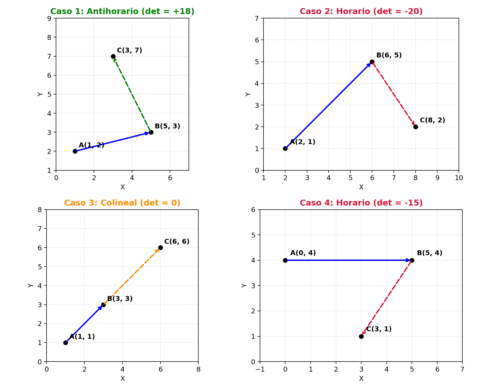
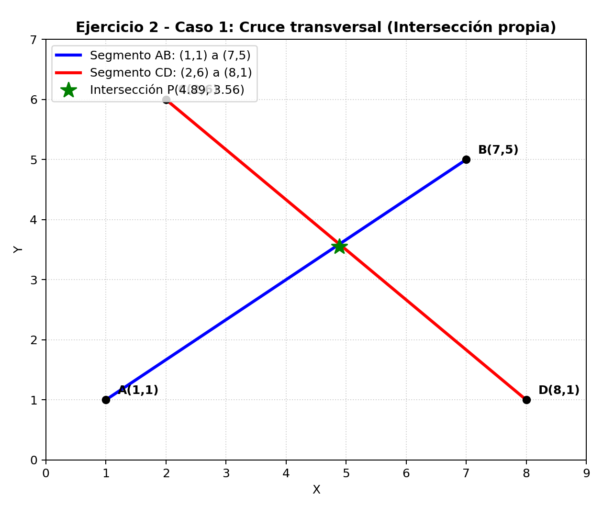
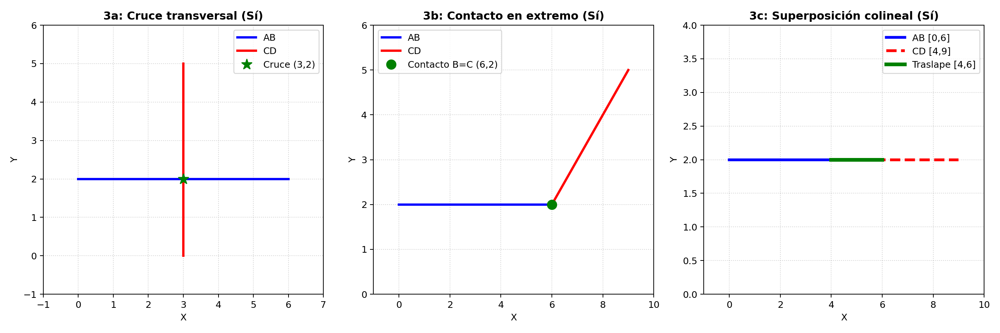
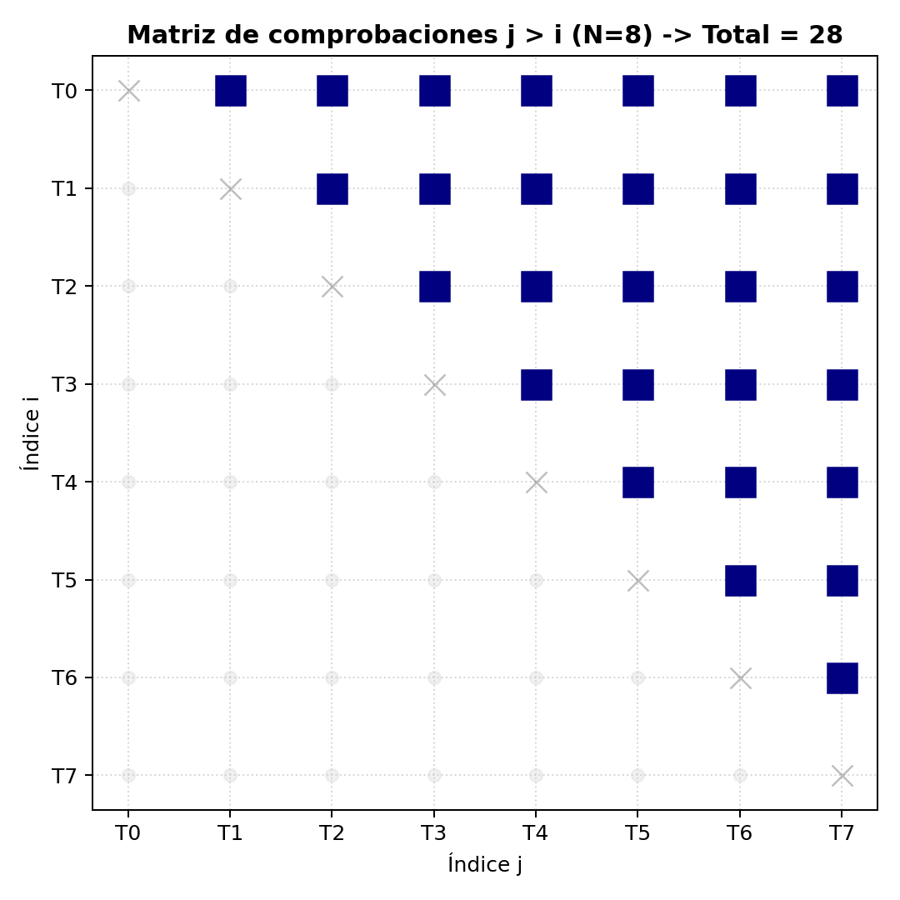
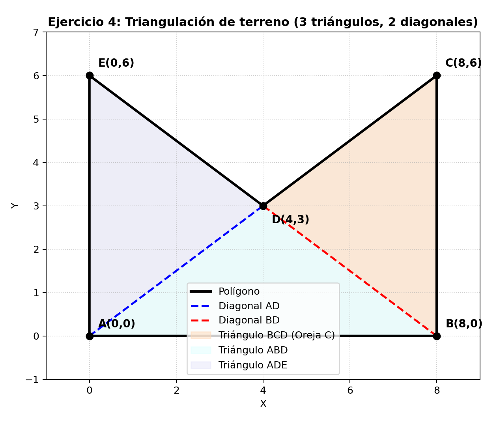

# Taller de algoritmos: geometría computacional

Solución de los 4 ejercicios con cálculos, figuras y código en Python.
Las figuras están en `img/` y se regeneran con `python figuras.py` (requiere `matplotlib`).

**Contenido:** [Ejercicio 1](#ejercicio-1-dirección-del-giro-de-un-robot) · [Ejercicio 2](#ejercicio-2-intersección-de-segmentos) · [Ejercicio 3](#ejercicio-3-comprobaciones-entre-tuberías) · [Ejercicio 4](#ejercicio-4-triangulación-de-un-terreno)

La función base de todo el taller es la **orientación** de tres puntos:

$$
\operatorname{orient}(P,Q,R)=(Q_x-P_x)(R_y-P_y)-(Q_y-P_y)(R_x-P_x)
$$

| Resultado | Significado |
|:---:|---|
| $> 0$ | Giro antihorario |
| $< 0$ | Giro horario |
| $= 0$ | Colineales |

---

## Ejercicio 1: dirección del giro de un robot

Un robot usa tres puntos: $A$ (posición anterior), $B$ (actual) y $C$ (destino).

| Caso | A | B | C | Sustitución | det | Giro |
|:---:|:---:|:---:|:---:|---|---:|---|
| 1 | (1, 2) | (5, 3) | (3, 7) | $(4)(5)-(1)(2)$ | 18 | Antihorario |
| 2 | (2, 1) | (6, 5) | (8, 2) | $(4)(1)-(4)(6)$ | −20 | Horario |
| 3 | (1, 1) | (3, 3) | (6, 6) | $(2)(5)-(2)(5)$ | 0 | Colineal |
| 4 | (0, 4) | (5, 4) | (3, 1) | $(5)(-3)-(0)(3)$ | −15 | Horario |



### Código

```python
def orientacion(P, Q, R):
    return (Q[0]-P[0])*(R[1]-P[1]) - (Q[1]-P[1])*(R[0]-P[0])

def clasificar(det):
    return "Antihorario" if det > 0 else "Horario" if det < 0 else "Colineal"

casos = {"Caso 1": ((1,2),(5,3),(3,7)), "Caso 2": ((2,1),(6,5),(8,2)),
         "Caso 3": ((1,1),(3,3),(6,6)), "Caso 4": ((0,4),(5,4),(3,1))}

for nombre, (A, B, C) in casos.items():
    d = orientacion(A, B, C)
    print(f"{nombre}: det = {d:>4} -> {clasificar(d)}")
```

### Complejidad $T(n)$

Cada caso hace un número fijo de operaciones. Con $n$ casos:

$$
T(n)=c_1 n+c_2 \;\Rightarrow\; T(n)=O(n)
$$

El espacio es $O(n)$ si se guardan los resultados. Con los 4 casos dados, $n$ es constante.

---

## Ejercicio 2: intersección de segmentos

Los segmentos $AB$ y $CD$ se cruzan si $\operatorname{orient}(A,B,C)$ y $\operatorname{orient}(A,B,D)$ tienen signos opuestos, y lo mismo ocurre con $\operatorname{orient}(C,D,A)$ y $\operatorname{orient}(C,D,B)$. Si alguna orientación vale 0, se comprueba si ese punto está dentro del otro segmento (contacto o superposición).

### Caso principal: $A(1,1)$, $B(7,5)$, $C(2,6)$, $D(8,1)$

$$
\begin{aligned}
\operatorname{orient}(A,B,C)&=(6)(5)-(4)(1)=26\\
\operatorname{orient}(A,B,D)&=(6)(0)-(4)(7)=-28\\
\operatorname{orient}(C,D,A)&=(6)(-5)-(-5)(-1)=-35\\
\operatorname{orient}(C,D,B)&=(6)(-1)-(-5)(5)=19
\end{aligned}
$$

Los signos son opuestos en ambas parejas, así que **sí se cruzan**, en $P\approx(4.89,\,3.59)$.



### Caso 2: $A(1,1)$, $B(3,3)$, $C(5,5)$, $D(7,7)$

Las cuatro orientaciones valen 0 porque todos los puntos están en $y=x$. Hay que revisar los intervalos: $AB$ ocupa $x\in[1,3]$ y $CD$ ocupa $x\in[5,7]$. No se tocan, así que **no hay intersección**.


### Caso 3: $A(0,2)$, $B(6,2)$

El enunciado solo da el segmento $AB$; falta $CD$. Para mostrar los tres comportamientos posibles se usan tres $CD$ hipotéticos (reemplázalos por los datos reales):

| Variante | C | D | ABC | ABD | CDA | CDB | ¿Intersección? |
|---|:---:|:---:|---:|---:|---:|---:|---|
| 3a: cruce | (3, 0) | (3, 5) | −12 | 18 | 15 | −15 | Sí |
| 3b: contacto en B | (6, 2) | (9, 5) | 0 | 18 | 18 | 0 | Sí |
| 3c: superposición | (4, 2) | (9, 2) | 0 | 0 | 0 | 0 | Sí |



### Código

```python
def signo(v):
    return (v > 0) - (v < 0)

def en_segmento(P, Q, R):
    """¿Q (colineal con P y R) está dentro del segmento PR?"""
    return (min(P[0], R[0]) <= Q[0] <= max(P[0], R[0]) and
            min(P[1], R[1]) <= Q[1] <= max(P[1], R[1]))

def interseccion(A, B, C, D):
    o1 = signo(orientacion(A, B, C)); o2 = signo(orientacion(A, B, D))
    o3 = signo(orientacion(C, D, A)); o4 = signo(orientacion(C, D, B))
    if o1 * o2 < 0 and o3 * o4 < 0:          # cruce propio
        return True
    return ((o1 == 0 and en_segmento(A, C, B)) or
            (o2 == 0 and en_segmento(A, D, B)) or
            (o3 == 0 and en_segmento(C, A, D)) or
            (o4 == 0 and en_segmento(C, B, D)))

print(interseccion((1,1), (7,5), (2,6), (8,1)))   # True
print(interseccion((1,1), (3,3), (5,5), (7,7)))   # False
print(interseccion((0,2), (6,2), (3,0), (3,5)))   # True
print(interseccion((0,2), (6,2), (6,2), (9,5)))   # True
print(interseccion((0,2), (6,2), (4,2), (9,2)))   # True
```

### ¿Por qué es $O(1)$?

Siempre se hacen 4 orientaciones y, como máximo, 4 comprobaciones de pertenencia. Cada una es aritmética sobre 8 coordenadas, sin ciclos. El tiempo no depende de la longitud de los segmentos:

$$
T=c=O(1),\qquad S=O(1)
$$

Comparar una lista de $n$ segmentos contra otros $m$ cuesta $O(nm)$, aunque cada comparación sea $O(1)$.

---

## Ejercicio 3: comprobaciones entre tuberías

```python
for i in range(n):
    for j in range(i + 1, n):
        interceptan(tubos[i], tubos[j])
```

### 1. ¿Por qué `j = i + 1`?

Con `j = i + 1` cada par se revisa una sola vez. Si `j` empezara en 0, una tubería se compararía consigo misma ($i=j$) y se repetirían pares: $(0,1)$ y $(1,0)$ son la misma comprobación.



### 2. Tablas de iteraciones

**N = 5**

| $i$ | Valores de $j$ | Comprobaciones |
|---:|---|---:|
| 0 | 1, 2, 3, 4 | 4 |
| 1 | 2, 3, 4 | 3 |
| 2 | 3, 4 | 2 |
| 3 | 4 | 1 |
| 4 | ninguno | 0 |
| | **Total** | **10** |

**N = 8**

| $i$ | Valores de $j$ | Comprobaciones |
|---:|---|---:|
| 0 | 1, 2, 3, 4, 5, 6, 7 | 7 |
| 1 | 2, 3, 4, 5, 6, 7 | 6 |
| 2 | 3, 4, 5, 6, 7 | 5 |
| 3 | 4, 5, 6, 7 | 4 |
| 4 | 5, 6, 7 | 3 |
| 5 | 6, 7 | 2 |
| 6 | 7 | 1 |
| 7 | ninguno | 0 |
| | **Total** | **28** |

### 3 y 4. Expresión exacta y simplificación

$$
T(n)=\sum_{i=0}^{n-1}\sum_{j=i+1}^{n-1}1=\sum_{i=0}^{n-1}(n-1-i)=(n-1)+(n-2)+\cdots+1+0=\frac{n(n-1)}{2}=\binom{n}{2}
$$

$$
T(n)=\tfrac12 n^2-\tfrac12 n \;\Rightarrow\; T(n)=\Theta(n^2)
$$

El espacio es $O(1)$.

### 5. Cantidades grandes

| $n$ | $n(n-1)/2$ | Comprobaciones |
|---:|---|---:|
| 100 | $100\cdot 99/2$ | 4.950 |
| 1.000 | $1000\cdot 999/2$ | 499.500 |
| 10.000 | $10000\cdot 9999/2$ | 49.995.000 |

```python
def contar_pares(n):
    c = 0
    for i in range(n):
        for j in range(i + 1, n):
            c += 1                      # aquí iría interceptan(tubos[i], tubos[j])
    return c

for n in (5, 8, 100, 1000):
    assert contar_pares(n) == n * (n - 1) // 2
```

---

## Ejercicio 4: triangulación de un terreno

Polígono $A(0,0)\to B(8,0)\to C(8,6)\to D(4,3)\to E(0,6)\to A$. El recorrido es antihorario (área = 36), así que $\det>0$ es convexo y $\det<0$ es cóncavo.

### 1. Vértices convexos y cóncavos, y prueba de oreja

| Vértice | Vecinos | det | Tipo | ¿Oreja? |
|:---:|:---:|---:|---|---|
| A | E, B | 48 | Convexo | No válida: $D$ cae sobre la diagonal $EB$ |
| B | A, C | 48 | Convexo | No válida: $D$ cae sobre la diagonal $AC$ |
| C | B, D | 24 | Convexo | **Oreja válida** |
| D | C, E | −24 | **Cóncavo** | No |
| E | D, A | 24 | Convexo | **Oreja válida** |

Ejemplo en $D$, con vecinos $C$ y $E$:

$$
\operatorname{orient}(C,D,E)=(4-8)(6-6)-(3-6)(0-8)=0-24=-24
$$

### 2. Triángulos y diagonales internas

$$
\text{triángulos}=n-2=3,\qquad \text{diagonales internas}=n-3=2
$$

### 3. Triangulación válida

Triángulos $ABD$, $BCD$ y $ADE$, con diagonales $AD$ y $BD$. Cada triángulo tiene área 12 y suman 36, el área del terreno.



### 4. Primera oreja

El vértice $C$ es una oreja válida: es convexo y el triángulo $BCD$ no contiene otros vértices. Al recortarlo queda $A\to B\to D\to E$, donde $D$ es colineal con $B$ y $E$; la diagonal $AD$ termina la triangulación.

### 5. Condiciones antes de retirar un vértice

1. El vértice es convexo ($\det>0$).
2. El triángulo con sus dos vecinos no contiene otro vértice, ni dentro ni sobre su borde.
3. La diagonal entre los vecinos queda dentro del polígono y no cruza aristas.
4. El polígono restante sigue siendo simple.
5. El proceso termina cuando quedan 3 vértices.

### 6. Código

```python
def triangulacion(n):
    """Triángulos y diagonales internas de un polígono simple de n vértices."""
    if n < 3:
        raise ValueError("Un polígono necesita al menos 3 vértices")
    return n - 2, n - 3

print(triangulacion(5))   # (3, 2)
```

La función es $O(1)$. Un ear clipping directo cuesta $O(n^3)$; guardando la lista de vértices cóncavos baja a $O(n^2)$.
